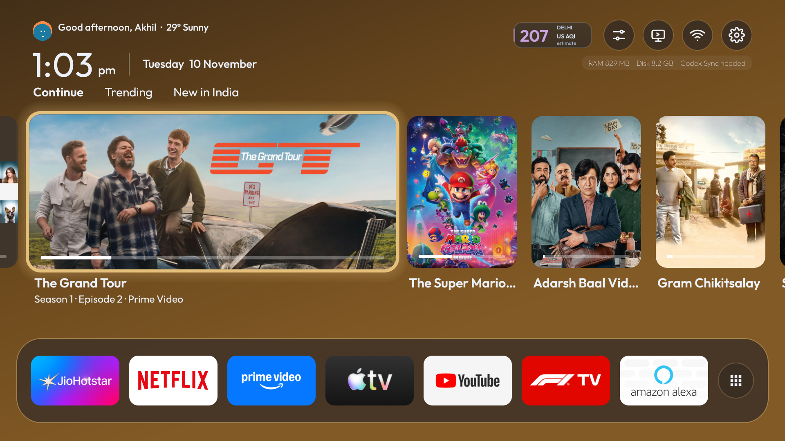
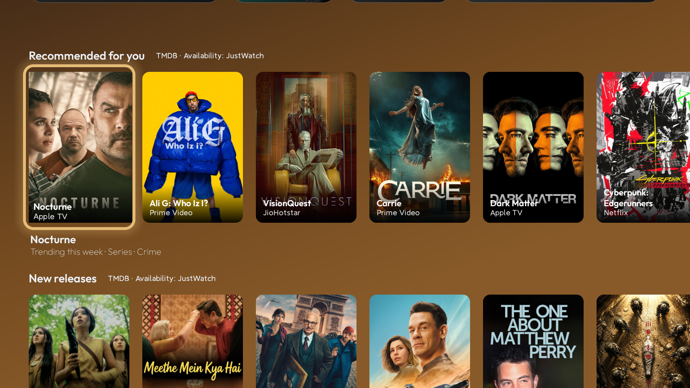
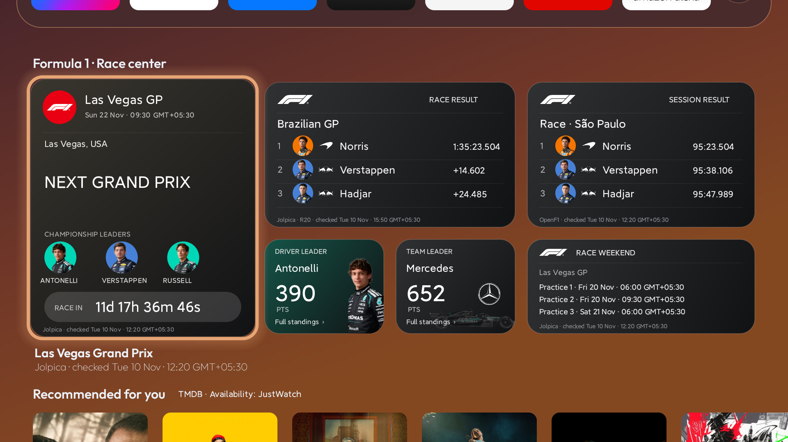

# Sweep TV

A native Android TV launcher customized from [Talkies](https://github.com/rajupp/talkies), with local profiles, content discovery and a Formula 1 dashboard. Companion website source lives in `website/`.

[Screenshots](#screenshots) · [Install](#install) · [First-time setup](#first-time-setup) · [What you get](#what-you-get) · [Updates](#updates) · [Troubleshooting](#troubleshooting) · [Credits](#credits-and-licenses)

## Screenshots

Captured on a Redmi TV running Android TV 10. Select any image to view it at full size.

[](website/dist/assets/home-grand-tour.png)

| Recommendations and new releases | Formula 1 race center |
| --- | --- |
| [](website/dist/assets/recommendations.png) | [](website/dist/assets/formula-one.png) |

## Install

Sweep TV targets **Android TV and Google TV running Android 8.0 or newer** on devices that permit APK installation. Check the TV’s operating system before downloading. The [companion website](https://sweep-tv.akhiltaneja04.chatgpt.site/#setup) has the same setup steps and a prompt builder.

| Method | What you need |
| --- | --- |
| [Without a computer](#without-a-computer) | The signed APK and an Android phone with Send Files to TV, or a USB drive and a TV file manager |
| [With a computer](#with-a-computer) | Android Platform Tools and a TV that allows debugging |
| [With a coding assistant](#with-a-coding-assistant) | A coding assistant with terminal access on a computer that can reach the TV |

### Without a computer

1. Download **sweep-tv.apk** from the [signed preview release](https://github.com/akhiltaneja/SweepMyTv/releases/tag/v1.3.0-sweep.25) or the [companion website](https://sweep-tv.akhiltaneja04.chatgpt.site/#download). Both downloads currently require sign-in. The release includes `SHA256SUMS`.
2. Install [Send Files to TV](https://play.google.com/store/apps/details?id=com.yablio.sendfilestotv) on an Android phone and the TV. Put them on the same Wi-Fi and send the APK to the TV. You can also copy the file to a USB drive and open it with a file manager on the TV.
3. Open the APK. If Android prompts you, allow the app opening the file to install unknown apps, then choose **Install**. Open **Sweep TV** from the TV’s Apps list.

A Sweep TV Downloader code requires a signed APK link that works without sign-in. Use the file-transfer steps for the current preview.

### With a computer

1. Download the signed APK and verify its SHA-256 against the release manifest. Install [Android Platform Tools](https://developer.android.com/tools/releases/platform-tools) on the computer.
2. In the TV’s **About** screen, select the build number repeatedly to enable Developer options. Enable the debugging option your TV provides. Find its IP address in Network settings and accept the TV’s debugging prompt when connecting. For TVs that show a pairing code and port, use the [Android wireless debugging instructions](https://developer.android.com/tools/adb#connect-to-a-device-over-wi-fi).
3. Run the commands below with your TV’s address and the APK filename you downloaded. Open Sweep TV from Apps after the install.

```sh
adb connect 192.168.1.100:5555
adb -s 192.168.1.100:5555 install -r sweep-tv.apk
```

### With a coding assistant

Use [the website’s setup prompt builder](https://sweep-tv.akhiltaneja04.chatgpt.site/#setup) after downloading the APK and enabling debugging on the TV. It includes the expected package and checksum, and asks the assistant to get your approval before granting extra permissions or changing the TV’s cleanup settings.

### First-time setup

| If you want | Where to go |
| --- | --- |
| Sweep TV as your Home screen | Try **Sweep TV settings → Home app** on TVs that expose a launcher choice. If the remote still opens the stock launcher, **Finish setup → Home button** opens Accessibility settings for the Sweep TV helper. |
| Continue Watching and Now Playing | Review **Notification access** and **Watch Next** in **Finish setup**. The available controls depend on your TV. |
| Recommendations and weather | Use **Keys and location** to enter your own TMDB key and choose a location. Keep your key out of chats and issues. |
| Animation controls or accessibility self-repair | These features can use the optional `WRITE_SECURE_SETTINGS` grant. Approve this separately if you need them. |

## Current preview


**1.3.0-sweep.25 · build 71** is a pre-release candidate. It prefers promotional landscape covers with title text in Continue Watching, Trending and release shelves, with intact portrait-poster fallback. Its 31 focused Android checks and 10 upstream gate checks passed; lint reported no errors and 70 warnings. **Physical-TV verification is pending.** The previous build, 1.3.0-sweep.24 (70), was installed and checked on a Xiaomi/Redmi MiTV-MOOQ1 running Android TV 10. Other devices require individual verification.

## What you get

- Local profiles, persistent circular avatars and original-language preferences for recommendations. Continue Watching remains independent of that language filter.
- Continue Watching with progress/resume links, a YouTube inclusion toggle, and title-artwork or playback-still choices where sources provide them.
- TMDB discovery, trending and new-release shelves. Artwork availability varies; no sharpening, resolution upscaling or guarantee of identical streaming-app artwork.
- Dark solar/weather gradients and a compact rotating air-quality estimate, headline and local-holiday badge.
- F1 schedule, countdown, published classifications and standings. Free data only; no claim of live timing access.
- Popup settings, configurable home sections and one managed Sweep TV release screen with component notes.

See [Releases](https://github.com/akhiltaneja/SweepMyTv/releases) for the signed APK, source archive, checksums and verification notes. The repository excludes signing keys, API keys, personal TV backups, raw diagnostic recordings and local SDKs. This is an early preview; physical volume-button hold behavior remains unresolved. Performance work reduces unnecessary drawing/loading, but measurements do not establish a universal FPS improvement.

## Build and check

Use JDK 17, Android SDK platform 35 / build-tools 35.0.0, and the Gradle wrapper in `launcher/`. The local helper `launcher/build-preview.sh` expects SDK/JDK tooling in `tools/` as described by its checks; `JAVA_HOME` can override its JDK. Configure your own signing key. A self-built APK with another certificate cannot update the distributed APK in place.

```sh
cd launcher
./build-preview.sh
```

The helper runs upstream checks, Android unit tests, release assembly and lint; it never connects to a TV. [Upstream maintenance](launcher/UPSTREAM_UPDATES.md) documents the pinned CleanYourTV review and packaging gate. Included shared code is reviewed through **CleanYourTV v3.4.0**, not a wholesale import of its launcher or cleanup rules.

```sh
cd website
npm run check
npm run dev
```

The website is static HTML/CSS/JS with no runtime dependencies or analytics. `npm run prepare:site` is for the maintainer's release workspace and requires its separately stored verified release artifacts and screenshot inputs. The tracked `website/dist/` contains the prepared page, metadata and curated screenshots; APK binaries are release assets.

## Updates

Check [GitHub Releases](https://github.com/akhiltaneja/SweepMyTv/releases) for the signed APK, release notes, component versions and checksums. To update an existing Sweep TV installation, install a newer APK signed with the same key over it. The app’s Sweep TV release screen shows the installed build and its component notes.

## Troubleshooting

| What you see | What to check |
| --- | --- |
| APK fails to install | Check Android version, storage and the install permission for the app opening the APK. If Android reports a signing conflict, identify the installed build and back up settings before removing it. |
| Home opens the stock launcher | Check **Home app** and **Finish setup → Home button**. On some models, sideloading restricts Accessibility. Follow the settings link in Finish setup or use the assisted route. |
| Debugging connection refused | Check that the TV is awake, the address and port match its settings, and both devices are on the same network. Some models require wireless pairing. |
| Continue Watching is empty | Check Notification access and Watch Next. Streaming apps vary in the playback information they make available. |

To return to the original launcher, turn off the Sweep TV Accessibility helper if enabled, then choose the original app in the TV’s Home app settings where available. Keep the stock launcher installed. Any optional cleanup is a separate device-specific change, with its own recovery record and approval. The companion website prepares instructions in your browser.

## Credits and licenses

See [LICENSE](LICENSE), [third-party notices](launcher/THIRD_PARTY_NOTICES.md) and the individual asset notices. Talkies and selected CleanYourTV components retain their original credits. Other adapted code and bundled avatar/font/media assets retain their respective licenses. Streaming services, TMDB and Formula 1 do not endorse this project.
