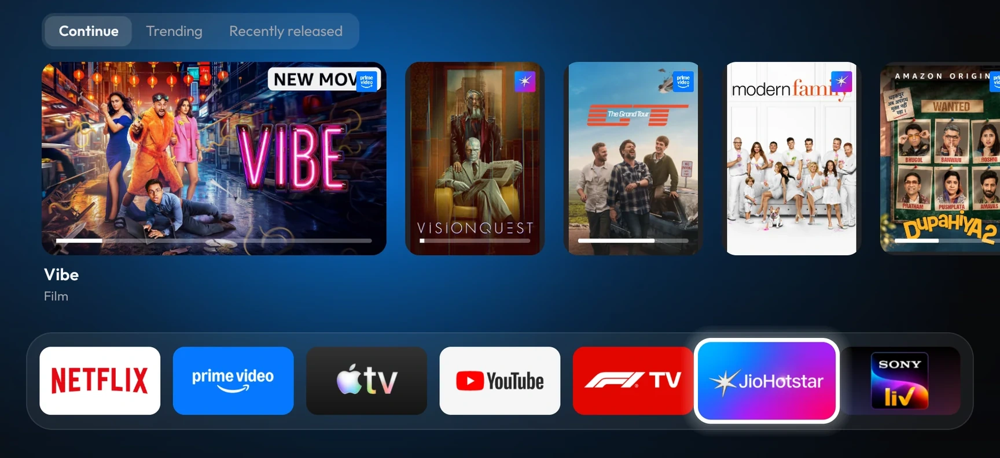
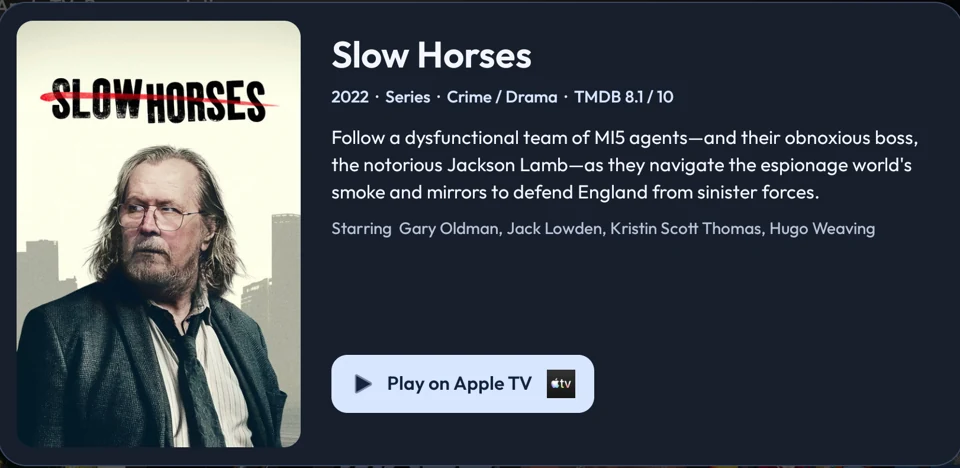
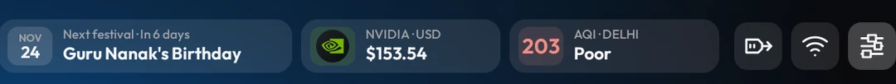
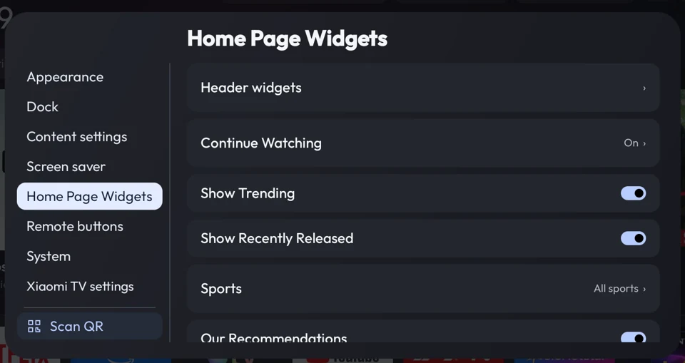

<div align="center">
  
  <h1>SweepMyTV</h1>
  <p><strong>A customizable home screen for Android TV and Google TV.</strong></p>
  <p>Keep your apps in reach, pick up what you were watching, and check the next race from Home.</p>
  <p>
    <a href="https://github.com/akhiltaneja/SweepMyTv/releases">Download preview</a> ·
    <a href="#install">Install guide</a> ·
    <a href="#feature-tour">Feature tour</a> ·
    <a href="#tested-tvs">Tested TVs</a>
  </p>
</div>

[](docs/media/sweep-home.webp)

Screenshots show development builds running on a Redmi TV. Check the [release notes](https://github.com/akhiltaneja/SweepMyTv/releases) for features included in the downloadable build.

<details>
<summary>See the original Android TV Home</summary>


</details>

## Install

Sweep TV targets **Android TV and Google TV devices running Android 8.0 or newer** that allow APK installation. The supported setup uses your existing TV and remote and requires no root.

1. **Download.** Get `sweep-tv.apk` from the [signed preview release](https://github.com/akhiltaneja/SweepMyTv/releases/tag/v1.3.0-sweep.25). The release also includes SHA-256 checksums.
2. **Send to the TV.** On an Android phone, use [Send Files to TV](https://play.google.com/store/apps/details?id=com.yablio.sendfilestotv) on the same Wi-Fi. A USB drive and a TV file manager also work.
3. **Install and open.** Open the APK on the TV, allow the file app to install it if prompted, then open Sweep TV from Apps.

<details>
<summary>Install from a computer with ADB</summary>

Install [Android Platform Tools](https://developer.android.com/tools/releases/platform-tools) and verify the preview APK against its release checksum. Enable debugging in your TV’s Developer options, find its IP address, and accept its debugging prompt. Use your TV’s address in the commands below.

```sh
adb connect 192.168.1.100:5555
adb -s 192.168.1.100:5555 install -r sweep-tv.apk
```

If the TV shows a pairing code, follow [Android’s wireless debugging guide](https://developer.android.com/tools/adb#connect-to-a-device-over-wi-fi). Open Sweep TV from Apps after installation.

</details>

<details>
<summary>Get help from a coding assistant</summary>

Download the signed APK, enable TV debugging, and open the [setup prompt builder](https://sweep-tv.akhiltaneja04.chatgpt.site/#setup). The prompt includes the package and checksum and asks for your approval before extra grants or device-specific cleanup.

</details>

### First-time setup

- **Home button.** Use your TV’s Home app picker if it has one. If the remote opens stock Home, check **Finish setup → Home button** for the optional Sweep TV helper.
- **Continue Watching.** **Finish setup** links to Notification access and Read TV listings where your TV exposes them. Streaming apps decide what playback information they share.
- **Catalog and location.** App-published suggestions can work without a TMDB key. Configure an optional key for catalog discovery where that option is available. Edit the city in **System → Weather location** if the automatic estimate is wrong.
- **Advanced controls.** Some animation and accessibility repair features can use the optional `WRITE_SECURE_SETTINGS` grant.

**Current download** · `1.3.0-sweep.25` (build 71) is a prerelease that passed local checks. On-device verification for that exact package is pending. The [Tested TVs](#tested-tvs) notes name the build that was checked on hardware.

## Feature tour

### Continue Watching

Resume a title from Home when the streaming app shares a title and playback information with Android TV. Choose which supported apps appear in the row.


### Discover what to watch

Browse trending titles, recent releases, and shelves for supported apps. Use original-language preferences to narrow recommendations. Title details may include artwork, a synopsis, ratings, and a link to the title in its app. Exact title links depend on the provider and available metadata.

| Recommendations | Title details |
| --- | --- |
| [](docs/media/recommendations.webp) | [](docs/media/title-details.webp) |

The **SweepMyTV recommendation engine** is also in testing. The India beta checks artwork, streaming links, and availability before publishing picks. It skips rent-only offers and can be tested without entering a personal TMDB key. Availability in a given build is listed in its release notes.

### Formula 1 and cricket

**Formula 1** shows the next race countdown, published session results, and championship standings. The free-data mode includes published results and session updates.

[](docs/media/formula-1.webp)

**Cricket** shows up to three scorecards, with live matches prioritized when the feed has them.

[](docs/media/cricket.webp)

### Dock, themes, and top bar

Pin your favourite apps and adjust the dock’s size, shape, and background. Choose Sunlight to follow the time of day, pick a fixed palette, or use colours drawn from artwork. Available quick-access controls and remote shortcuts vary by device.


[](docs/media/themes.webp)

Choose the top-bar widgets you want, including local air-quality estimates, holidays, market prices, and device status. Inputs, network, and settings are within reach.

[](docs/media/top-bar.webp)

### Home settings and Aerial Views

Choose which home sections appear, adjust content and display settings, or use the phone customization shortcut for supported options.

| Home Page Widgets settings | Aerial Views on the TV |
| --- | --- |
| [](docs/media/settings.webp) | [](docs/media/aerial-views.webp) |

Aerial Views is optional. Playback quality depends on your TV’s display and decoding capabilities and the available clip.

## Tested TVs

The **Redmi MiTV-MOOQ1** running Android TV 10 is our reference device. On 17 November 2026, we observed Home navigation, Formula 1, cricket, and one exact Apple TV title handoff on development build `1.3.0-sweep.132`. Fresh installation, the physical Power button, and sleep and wake were outside that test pass.

Trying a different model or firmware? **[Report your TV](https://github.com/akhiltaneja/SweepMyTv/issues/new?template=tv-test.yml)** with the model, firmware, SweepMyTV version, and what you tested. The form covers installation, physical buttons, standby, restart, streaming, and HDMI.

## Optional cleanup and recovery

Install Sweep TV by itself or review cleanup separately for your exact device and firmware. On the Redmi, a separate review covered selected Xiaomi promotional services, recommendations, and analytics. Disabling unused services can free resources, with results depending on the device and packages. [CleanYourTV’s model profiles](https://cleanyour.tv/tvs) are a starting point for a device-specific review.

Before disabling anything, keep the stock launcher installed and save a record of the changes. To return to stock Home, turn off Sweep TV’s Home helper if enabled and select your original launcher in the TV’s Home app picker where available. Use the saved recovery record to restore packages changed during cleanup.

## Updates and troubleshooting

Use [GitHub Releases](https://github.com/akhiltaneja/SweepMyTv/releases) for signed APKs, checksums, and component notes. An update must use the same signing certificate as the installed APK to preserve app data.

| What you see | What to check |
| --- | --- |
| APK fails to install | Check the Android version, free storage, the permission to install from the file app, and whether an existing build has a different signature. |
| Home opens the stock launcher | Check your TV’s Home picker and the optional helper under Finish setup. Sideloaded apps may need extra steps before Android lets you enable Accessibility. |
| ADB won't connect | Confirm the TV is awake, both devices are on the same network, and the IP and port match the TV’s settings. Some TVs require wireless pairing first. |
| Continue Watching is empty | Check the optional permissions in Finish setup and whether the streaming app publishes playback metadata. |
| Volume changes only one step when held | This remains an open issue on some remote setups. Include the model, firmware, and enabled remote options in your TV report. |

## Build and check

Use JDK 17, Android SDK platform 35, and build-tools 35.0.0. Run the launcher’s build helper from `launcher/`. Configure your own signing key for a signed package.

```sh
cd launcher
./build-preview.sh
```

The helper checks the reviewed upstream versions, runs Android tests, builds the APK, and runs lint. [Upstream maintenance notes](launcher/UPSTREAM_UPDATES.md) describe the pinned shared components and release checks.

For the static [companion website](website/README.md), run `npm run check` and `npm run dev` from `website/`.

## Credits and licenses

Sweep TV is based on [Talkies](https://github.com/rajupp/talkies) and includes selected [CleanYourTV](https://github.com/Gathin23/cleanyourtv) components. The optional [Aerial Views](https://github.com/theothernt/AerialViews) screensaver is an independent project. See the [MIT license](LICENSE) and [third-party notices](launcher/THIRD_PARTY_NOTICES.md) for code, artwork, feeds, fonts, and their respective credits.
