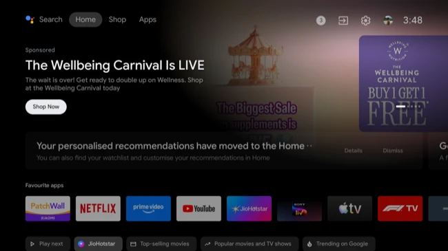
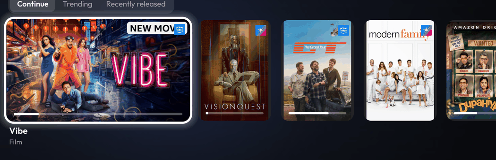
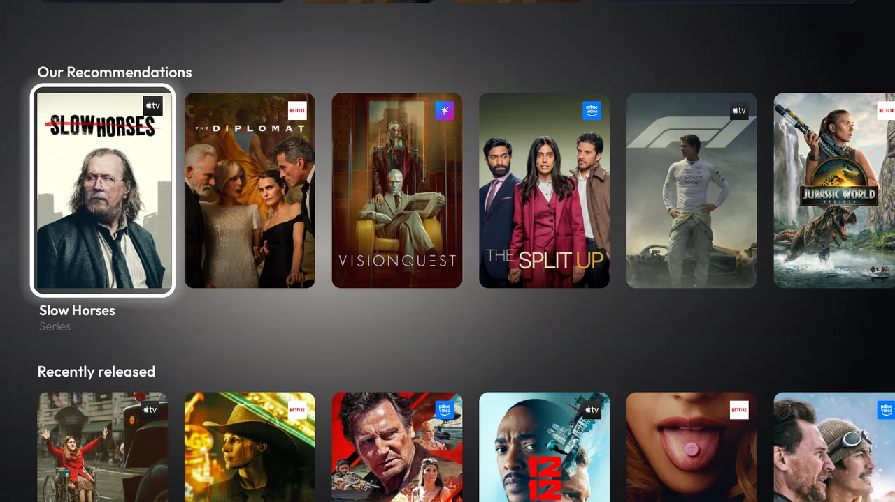
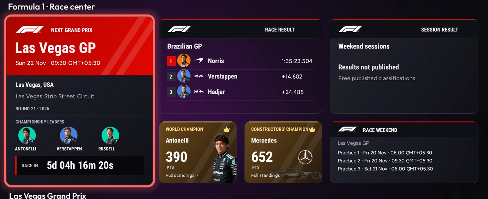
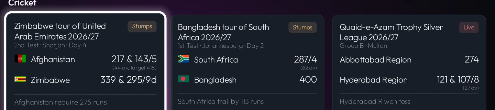
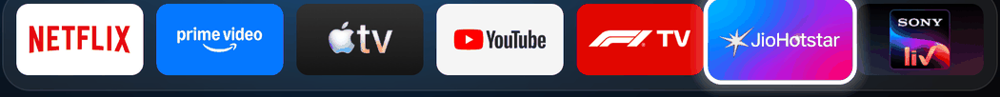
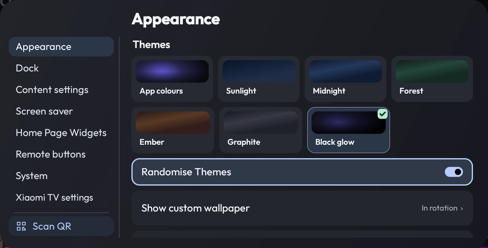

  
  <h1>SweepMyTV</h1>
  
<strong>A fast, lightweight launcher for Android TV and Google TV.</strong>

  
Customize your home screen, discover titles with the Sweep Recommendation Engine, and follow Formula 1 and cricket from Home.

  
<a href="https://sweepmytv.com/">SweepMyTV.com</a> · <a href="#feature-tour">Feature tour</a> · <a href="#tested-tvs">Tested TVs</a> · <a href="docs/building.md">Build from source</a> · <a href="https://github.com/akhiltaneja/SweepMyTv/releases">Releases</a>

> **[Install SweepMyTV from your phone →](docs/INSTALL.md)** 
> The guide also covers laptop setup and includes a copy-ready Claude Code prompt.

  

Screenshots show development builds running on a Redmi TV. Check the [release notes](https://github.com/akhiltaneja/SweepMyTv/releases) for features included in the downloadable build.

See the original Android TV Home

## Install

SweepMyTV runs on **Android TV and Google TV devices with Android 8.0 or newer** that allow APK installation. For phone, laptop, and assisted setup, see the [installation guide](docs/INSTALL.md). It also covers [first launch](docs/INSTALL.md#first-launch) and the optional Home and Continue Watching permissions.

**Current download** · `1.3.0-sweep.25` (build 71) is a prerelease that passed local checks. On-device verification for that exact package is pending. The [Tested TVs](#tested-tvs) notes name the build checked on hardware.

## Feature tour

### Continue Watching

Resume a title from Home when the streaming app shares a title and playback information with Android TV. Choose which supported apps appear in the row.

### Discover what to watch

Browse trending titles, recent releases, and shelves for supported apps. Use original-language preferences to narrow recommendations. Title details may include artwork, a synopsis, ratings, and a link to the title in its app. Exact title links depend on the provider and available metadata.

| Recommendations | Title details |
| --- | --- |
|  |  |

**Sweep Recommendation Engine v1 Beta** checks artwork, title links, and streaming availability before publishing picks. Prime Video picks exclude rent-only titles. You can try the engine without a personal TMDB key. Recommendation availability depends on your region, streaming apps, and build. See the [engine version history](https://sweepmytv.com/recommendation-engine.json).

### Formula 1 and cricket

**Formula 1** shows the next race countdown, published session results, and championship standings. The free-data mode includes published results and session updates.

**Cricket** shows up to three scorecards, with live matches prioritized when the feed has them.

### Dock, themes, and top bar

Pin your favourite apps and adjust the dock’s size, shape, and background. Choose Sunlight to follow the time of day, pick a fixed palette, or use colours drawn from artwork. Available quick-access controls and remote shortcuts vary by device.

Choose the top-bar widgets you want, including local air-quality estimates, holidays, market prices, and device status. Inputs, network, and settings are within reach.

### Home settings and Aerial Views

Choose which home sections appear, adjust content and display settings, or use the phone customization shortcut for supported options.

| Home Page Widgets settings | Aerial Views on the TV |
| --- | --- |
|  |  |

Aerial Views is optional. Playback quality depends on your TV’s display and decoding capabilities and the available clip.

## Tested TVs

The **Redmi MiTV-MOOQ1** running Android TV 10 is our reference device. On 17 November 2026, we observed Home navigation, Formula 1, cricket, and one exact Apple TV title handoff on development build `1.3.0-sweep.132`. Fresh installation, the physical Power button, and sleep and wake were outside that test pass.

Trying a different model or firmware? **[Report your TV](https://github.com/akhiltaneja/SweepMyTv/issues/new?template=tv-test.yml)** with the model, firmware, SweepMyTV version, and what you tested. The form covers installation, physical buttons, standby, restart, streaming, and HDMI.

## Optional cleanup and recovery

Install Sweep TV by itself or review cleanup separately for your exact device and firmware. On the Redmi, a separate review covered selected Xiaomi promotional services, recommendations, and analytics. Disabling unused services can free resources, with results depending on the device and packages. [CleanYourTV’s model profiles](https://cleanyour.tv/tvs) are a starting point for a device-specific review.

Before disabling anything, keep the stock launcher installed and save a record of the changes. To return to stock Home, turn off Sweep TV’s Home helper if enabled and select your original launcher in the TV’s Home app picker where available. Use the saved recovery record to restore packages changed during cleanup.

## Updates and troubleshooting

Use [GitHub Releases](https://github.com/akhiltaneja/SweepMyTv/releases) for signed APKs, checksums, and component notes. An update must use the same signing certificate as the installed APK to preserve app data.

| What you see | What to check |
| --- | --- |
| APK fails to install | Check the Android version, free storage, the permission to install from the file app, and whether an existing build has a different signature. |
| Home opens the stock launcher | Check your TV’s Home picker and the optional helper under Finish setup. Sideloaded apps may need extra steps before Android lets you enable Accessibility. |
| ADB won't connect | Confirm the TV is awake, both devices are on the same network, and the IP and port match the TV’s settings. Some TVs require wireless pairing first. |
| Continue Watching is empty | Check the optional permissions in Finish setup and whether the streaming app publishes playback metadata. |
| Volume changes only one step when held | This remains an open issue on some remote setups. Include the model, firmware, and enabled remote options in your TV report. |

## Build and check

The [build guide](docs/building.md) covers tool setup, Gradle commands, installing a local APK on a test TV, signing, and the maintainer release workflow.

For the static [companion website](website/README.md), run `npm run check` and `npm run dev` from `website/`.

## Credits and licenses

- **[CleanYourTV](https://github.com/Gathin23/cleanyourtv)** contributed selected components, including accessibility service recovery. The Control Center includes code from the earlier [tv-vibehack branch](https://github.com/samdegan2311/tv-vibehack/tree/pr/control-center).
- **[Talkies](https://github.com/rajupp/talkies)** contributed code retained in parts of the title row and media-session listener.
- **[Free My TV](https://github.com/simbasjungles/free-my-tv)** and **[Project Nayuki](https://www.nayuki.io/page/qr-code-generator-library)** contributed focus motion, phone setup, and QR code generation. **[Matinee](https://github.com/Jarvis322/matinee)** contributed speed-test code, **[Luma](https://github.com/0xProbabillity/luma-tv)** helped identify HDMI devices, and **[GlassLauncher](https://github.com/tlfares/GlassLauncher)** contributed app tiles for apps without TV banners.
- **[Aerial Views](https://github.com/theothernt/AerialViews)** is the independent project behind the optional screensaver.

See the [MIT license](LICENSE) and [third-party notices](launcher/THIRD_PARTY_NOTICES.md) for copyright notices and credits for code, artwork, data feeds, and fonts.
